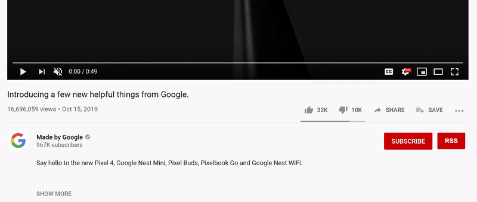

# Youtube RSS Button Plugin
This simple plugin adds back the RSS button that was removed from Youtube in 2014.  Add the extension to your browser, click the RSS button next to Subscribe on any video or channel page, and paste the link into your RSS reader.

## Installation
This extension is available on the [Chrome Web Store](https://chrome.google.com/webstore/detail/youtube-rss/cmkhdimgaondkfghelifknnpicdajeim).

## Demo
<p align="center">
  
</p>

## Uses

 - Retrieve channel RSS URLs easily
 - Subscribe to channels without an account.
 - Keep user privacy local.

## RSS Reader Recommendations
These readers are all open source projects.

 - [QuiteRSS](https://quiterss.org/)
 - [RSSOwl](http://www.rssowl.org/)
 - [Miniflux](https://miniflux.app/)

## If your reader says the feed is broken
The link the button copies is correct. Since late 2025, YouTube's own feed server has been failing at random, answering "not found" for about half of requests to feeds that work. Add the feed again, or wait for your reader's next check. Most readers retry on their own.

## Testing
`tests/check.mjs` loads the extension into Chromium and clicks the button on live YouTube video and channel pages, with no account needed:

```bash
cd tests && npm install && npm run check
```
